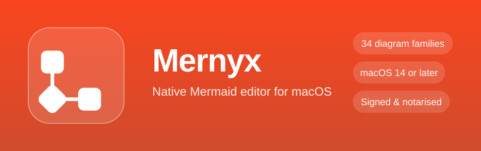
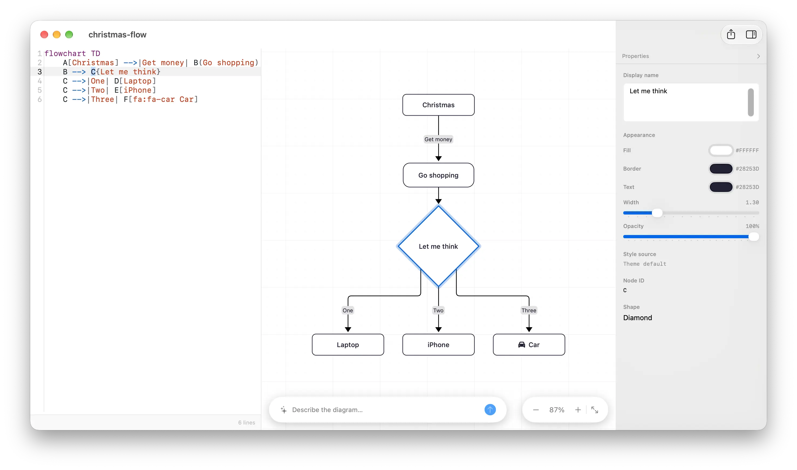

<p align="center">
  
</p>

# Homebrew tap for Mernyx

[Mernyx](https://mernyx.com) — native Mermaid editor for macOS. Move a node and
the source follows — no WebView, no JavaScript bridge, no Electron.

## Install

```sh
brew tap mernyx-app/mernyx
brew trust --tap mernyx-app/mernyx
brew install --cask mernyx
```

The `brew trust` step is required by Homebrew 7 before it will load a cask from a
third-party tap — without it, `brew install` refuses with "Refusing to load cask
… from untrusted tap".

After the tap is added, `brew install --cask mernyx` works on its own — Homebrew
falls back to this tap for the `mernyx` token.

<p align="center">
  
</p>

## What you get

This cask installs the **standalone (direct) build**, which uses a licence key
instead of the Mac App Store receipt. It is the same build offered on
[mernyx.com](https://mernyx.com).

- Mernyx Pro is a one-time $19 licence, sold on [mernyx.com/pricing](https://mernyx.com/pricing/).
- Requires macOS 14 or later.
- The app updates itself; this tap is the install path, not the update path.

## Notes

Mernyx uses the same bundle identifier as the App Store edition, so only one
copy can be installed at a time — installing one replaces the other. Store
purchases do not carry over to the direct build, and App Store receipts are not
read by it.

## Updating the cask

Because the app updates itself, `brew upgrade` does not move this cask forward.
Run `brew update` to pick up a newer cask, then `brew install --cask --force mernyx`
if you want the newer build in place.

## Uninstall

```sh
brew uninstall --cask mernyx
brew uninstall --cask --zap mernyx   # also removes preferences and caches
```

## Links

- Website: [mernyx.com](https://mernyx.com)
- Pricing: [mernyx.com/pricing](https://mernyx.com/pricing/)
- Support: [mernyx.com/support](https://mernyx.com/support/)
- Issues and discussion: [github.com/mernyx-app/mernyx](https://github.com/mernyx-app/mernyx)
